===========
Screenshots
===========

These are captured from the running game. ZangbandTK draws its screen as
characters with colour attributes, so what you see below *is* the screen: every
glyph in the position and colour the game put it in, at any size you care to
zoom to.

The world
=========

One whole world, seen on the overhead map. A game generates all of this from a
single seed, and it comes back the same every time (:doc:`wilderness`).

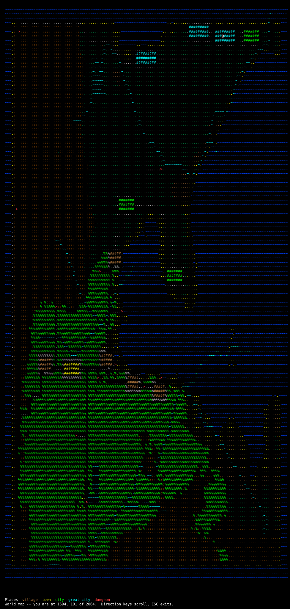
         sea, coast, forest, mountain and open country, with towns and dungeon
         mouths marked.
   :width: 100%

Blue is sea and light blue the shallows you can wade. Green is grassland, light
green forest, umber the mountains that are impassable. The ``@`` is the character
and ``>`` a dungeon mouth. The towns show as blocks because they're big: a great
city is 132 grids across, which is most of nine blocks.

This is the map with everything known. In play you only see what you've been
near. The map fills in behind you as you walk, and that's most of what the
:doc:`magetower <towns>` is for.

The surface
===========

The town isn't a level of its own with the wilderness somewhere else. It stands
in the same map, which scrolls as you walk.

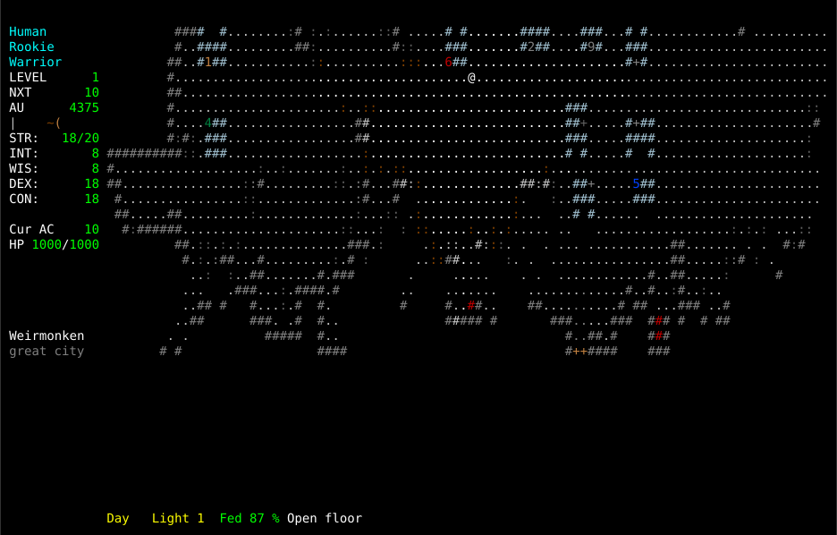
         visible through the gate, roads leading away, and open country around.
   :width: 100%

The numbers are shops and the ``+`` symbols are services: an inn, a healer, a
magesmith. The road leaves by the gate and goes somewhere. Every town and every
dungeon mouth in the world is on the network, which is how you find the next one.

Walk far enough in any direction and the window scrolls; walk far enough west and
you run out of land, then out of world.

The coast
=========

The western edge of the land.

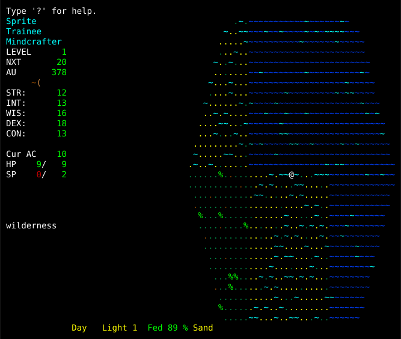
         view, the waterline running down the middle and grassland on the
         right, the character standing on the shore.

The sea is terrain like the land, not a wall drawn at the edge of the map.
Shallow water can be waded, and so can deep water, though not while you're
heavily laden. The game asks before it lets you try. The world has a coast on
every side, because the fractal that makes the land is bounded by ocean.

The ``N`` glyphs out on the water are fish, and they're the reason to think
twice about wading. They can't come ashore, so a character who stays on the sand
is in no danger from them at all. The sea is never tame, though, whatever the
law is like on the land beside it.

What a character can do
=======================

A Sprite Mindcrafter at the start of its career, with the power list open on
``N``. Everything on it is on one key, and none of it came out of a book.

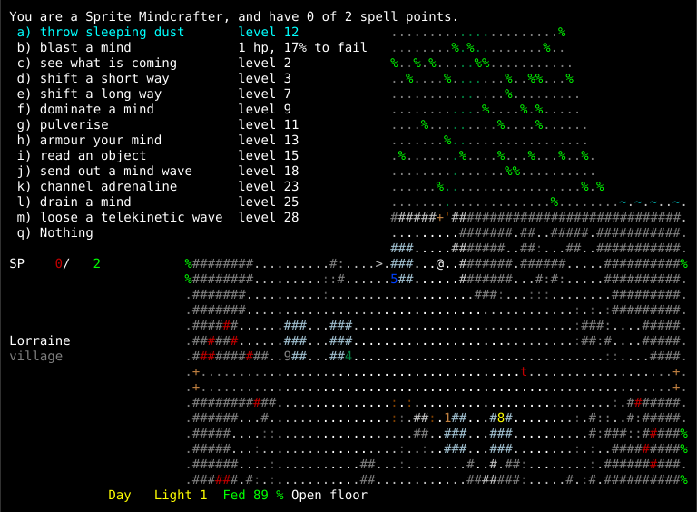
         twelve psionic ones with the level each arrives at and the chance of
         failing, over a view of the wilderness outside a village.
   :width: 100%

The first entry belongs to the race: a Sprite throws sleeping dust, though not
until level 12. The other twelve are the Mindcrafter's psionics
(:ref:`Psionics <psionics>`), listed with the level each arrives at and, for the
ones already available, the cost and the chance of failing. This character is
level 1, so *blast a mind* is the only one it can use.

It says ``1 hp`` instead of ``1 sp`` because this character has spent its mana
and hasn't slept since. A power takes spell points where there are any and hit
points where there aren't, and the menu tells you which before you commit. For
a Warrior or a Monk, who have no mana at all, it's always blood.

The sidebar names the place and its size, *Lorraine, village*, and the status
line says *Day*. Both are ZangbandTK's. Angband has no world for a town to sit
in, and no time of day for it to be.

What chaos has made of it
=========================

The third page of the character sheet: press ``C``, then ``h`` twice. Six
mutations on one character is a great many. Most characters who have any have
one or two.

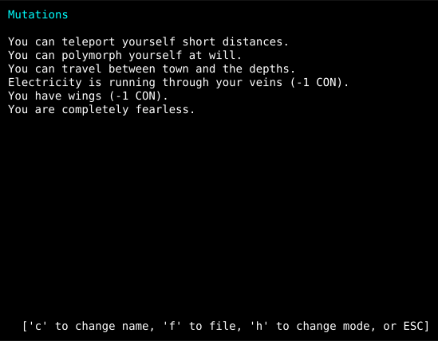
         description - short-range teleportation, polymorph, travel between town
         and the depths, electricity in the veins, wings, and fearlessness.
   :width: 100%

None of these was chosen. Mutations come from a Chaos-Warrior's patron, from a
polymorph, from a chaos attack, or just from being a Beastman, and they can't be
taken off the way a ring can. The first three are powers, used from the same
list as racial and class powers. The last three are always in effect.

Two of them charge for what they give: electricity in the veins and wings each
cost a point of constitution, and the page shows it. A mutation is rarely only
what it's called. The Zangband spoiler gives the headline of each and stops
there, and the headline is usually the good half. See :doc:`mutations`.

The page itself is ZangbandTK's, since Angband has no mechanism a mutation could
be built on. Before it was added, the only way to see the passive ones was to
write a character dump to a file and read it.

What fights for you
===================

Four pets, which is as many as will follow you down a staircase, and the menu
that commands them, on ``P``.

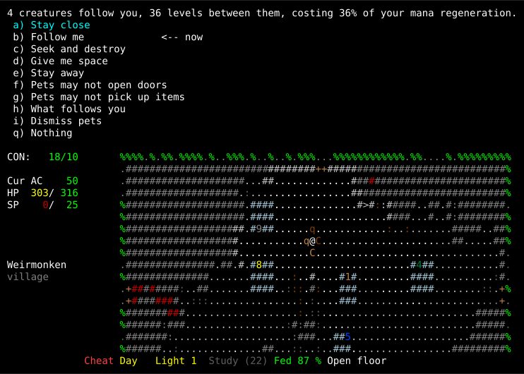
         distance orders with "Follow me" marked as current, two switches and
         two actions, above a character with two dogs and two bears standing
         around it.
   :width: 100%

The line above the menu is pet balance in one sentence: *4 creatures follow
you, 36 levels between them, costing 36% of your mana regeneration*. The charge
is on the sum of their levels, not on how many there are, and only past a free
allowance that grows with your character. So the third animal can cost more
than the two before it put together.

The orders are a policy, and every pet follows the same one. It survives a
save, and it applies to pets you haven't acquired yet.

Nothing on the map marks them as yours. The two ``C`` and two ``q`` beside the
``@`` are drawn exactly as they would be if they were about to eat you. A colour
was considered and turned down, because the glyph already has three rules
(multi-hued, purple uniques, shapechangers) and a fourth would lose to all of
them. Look at one (``l``) and it says *pet* before its health. The monster list
(``[``) counts them, so a row reads *4 kobolds (2 pets)*, which is the question
you have before firing into a crowd.

The **Cheat** marker in red at the bottom is there because these captures use
the debug commands to set the scene. Any character that has touched them keeps
that marker for as long as it exists; see :doc:`the cheating options <option>`.

The Tk front end
================

Everything above is the game drawn in characters, which every front end shares.
``ZangbandTK.app`` puts windows around it, modelled on the 1990s ZangbandTk,
and these five are screen captures of it on a Mac: one new character, a
Half-Elf Ranger, from the Birth window to the first steps in town.

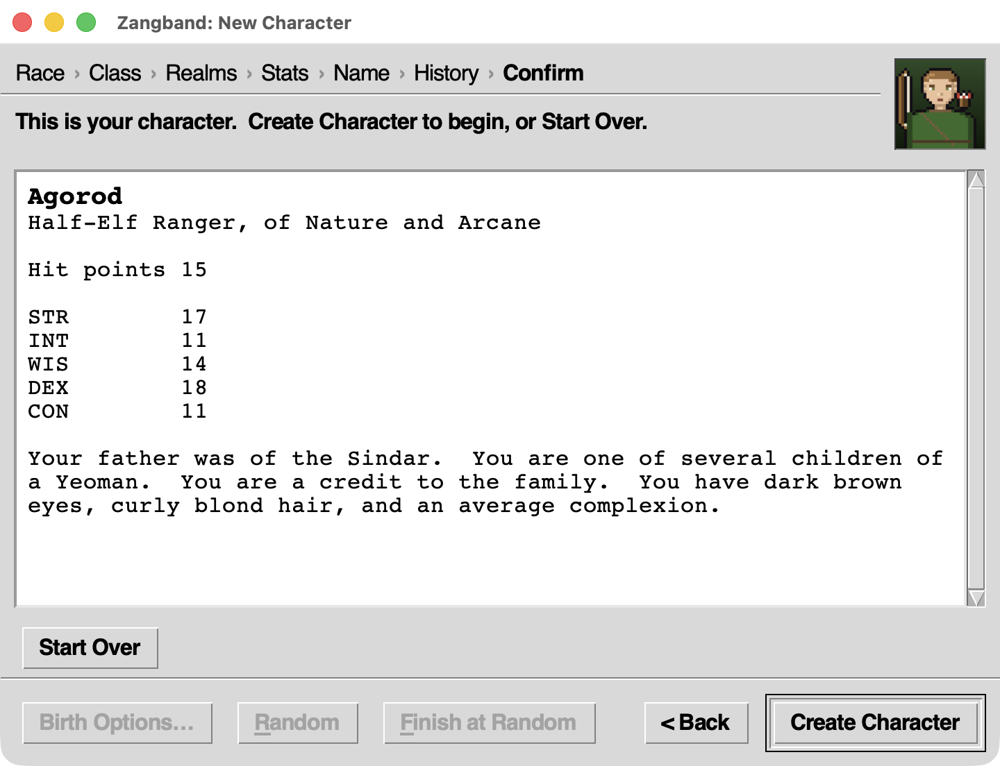
         of the Nature and Arcane realms with its hit points, five stats and
         family history, a pixel-art portrait at the top right, and the steps
         Race, Class, Realms, Stats, Name, History and Confirm across the top.
   :width: 100%

Making a character, without the text screens. The steps run along the top, and
Back goes back through them. The portrait in the corner follows your choices.
There's one for every race and class, as a man and as a woman, and the
character keeps it for the rest of its life.

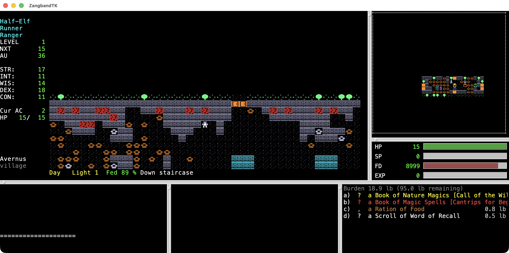
         the bottom of the view and the sidebar of stats on the left, the
         overhead map and bars for hit points, spell points, food and
         experience on the right, and three panes below, the last listing the
         pack.
   :width: 100%

The main window, a moment into the game, in the Neon tiles. The map has the
game's own sidebar and status line. Beside it is the overhead map, with bars for
hit points, spell points, food and experience under it. Below are the messages,
the recall pane, and the Choice pane, which shows the pack and answers the
game's questions about items with a click.

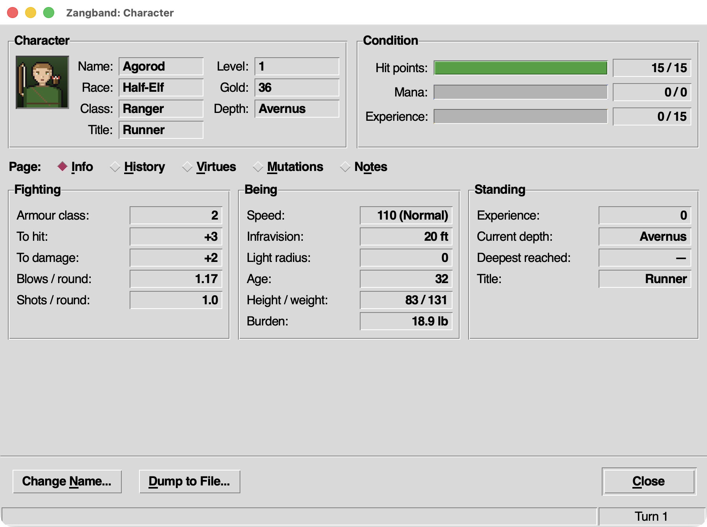
         title, level, gold and place, bars for hit points, mana and
         experience, and three panels headed Fighting, Being and Standing.
   :width: 100%

The Character window. Info is the first of its five pages. The others are the
character's background, its virtues, its mutations, and the game's notes on what
has happened to it. A Ranger has no mana at the first level, so that bar is
empty.

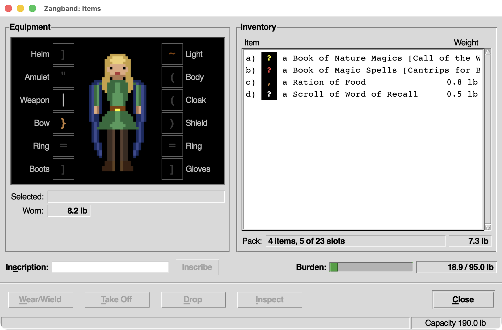
         slots on the left, the pack listed with weights on the right, and an
         inscription field, a burden bar and buttons to wear, take off, drop and
         inspect below.
   :width: 100%

The Items window: what is worn, on a paper doll, and what is carried, beside it.
The burden bar says how near the character is to being slowed by its load.

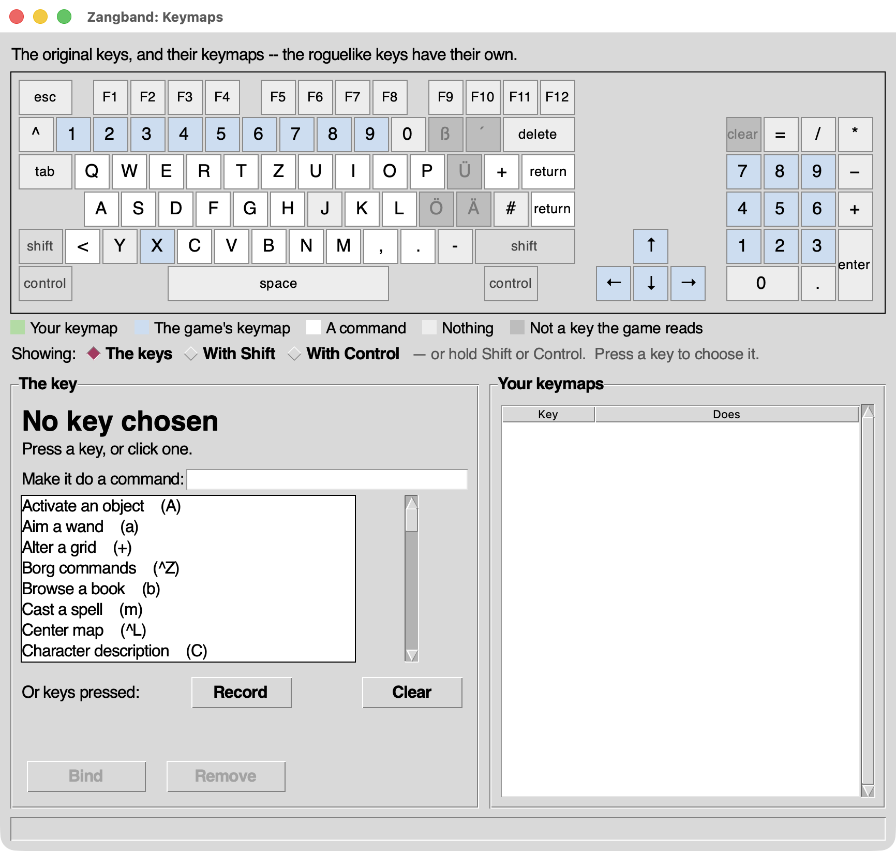
         function keys, arrows and numeric keypad, the keys coloured by what
         they do, with a list of commands to bind a key to below.
   :width: 100%

The Keymaps window draws the keyboard macOS says you have, so a German keyboard
shows its umlauts. Blue keys are the game's own keymaps (the number row and
the keypad walk), green ones are yours, and grey ones are keys the game can't
read. Click a key, then choose a command for it or record the keys it should
press.

How these were made
===================

With the game's own renderer, run headless. The test front end writes out
every character, position and colour the game draws, and a small script replays
that into a grid and writes SVG using Angband's own palette. A few of the debug
commands set the scene (*Know every place* to fill the map in, *Mutations* to
give the character the six on its sheet), and the terminal is larger than a
player would normally use, so the whole world fits in one frame.

That means these can't drift from the game. Regenerating them runs the current
code, not some build somebody had lying about.

The Tk front end's pictures are the exception. They're screen captures, taken by
a script that makes a character in a session of its own, opens each window and
photographs it on its own.

Still to come
=============

- The bestiary, showing the monsters Angband doesn't have. The capture can reach
  the knowledge browser but can't yet scroll it to a useful page.
- A vampiric or chaotic weapon discharging, since those mechanics have no Angband
  equivalent.
- A Chaos-Warrior's patron rewarding or punishing it on a level gained.

The last two need a fight and a level-up staged, which the harness can't do yet.
